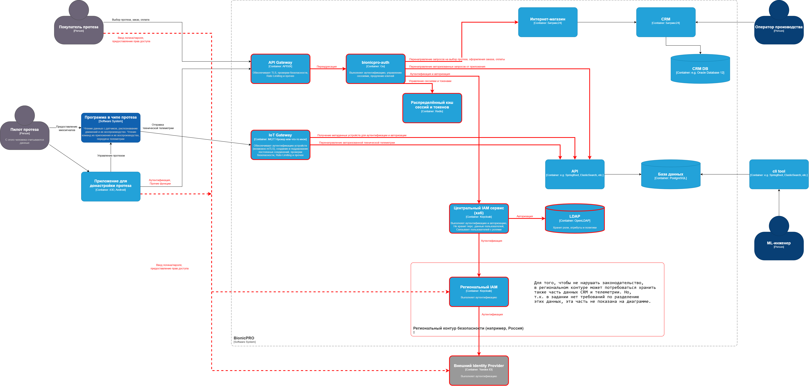
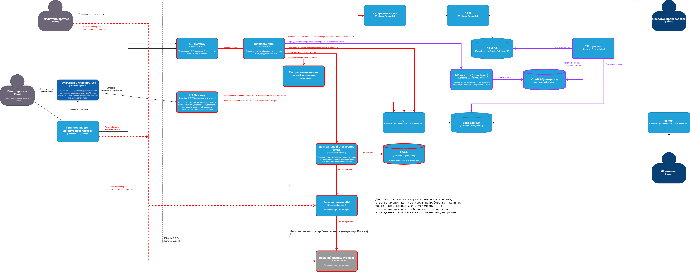

# Задание 1

## Решение по безопасности

### Общее

1. Поставить API Gateway для выполнения централизованной аутентификации и авторизации пользователей и специализированный IoT Gateway для приема телеметрии с протезов.
2. Использовать аутентификацию и авторизацию про совершении всех запросов пользователя, кроме просмотра публичных материалов при выборе протеза.
3. Вынести управление пользователями (IAM), аутентификацию и авторизацию в отдельный централизованный сервис (Keycloak).
4. Использовать внешние дочерние IAM и размещение внутри стран персональных данных пользователей из этих стран для удовлетворения требований местного законодалельства.
5. В качестве протокола аутентификации и авторизации использовать OIDC.
6. В качестве механизма авторизации использовать JWT-токены.
7. Использовать сессии, чтобы не передавать токены на устройства пользователей.

Диаграмма контейнеров C4:

### Выбор протокола аутентификации пользователей

В качестве протокола аутентификации и авторизации выбран **OIDC** построенный поверх протокола авторизации **OAuth 2.0**, потому что:

- Это современный протокол, поддерживаемый международными организациями. Протокол постоянно дополняется/улучшается в соответствии с актуальными требованиями безопасности и возможностями.
- Простой и гибкий в настройке, поддерживается большим количеством продуктов и библиотек.
- Изначально поддерживает Web и нативные устройства.
- Легковесный (JSON), может быть использован в IoT.
- В компании нет Legacy систем с которыми требовалась бы сложная интеграция.

**Альтернативы:**

- Протокол SAML был отклонён, т.к.:
    - Не имеет серьезных преимуществ перед OIDC.
    - Имеет недостатки, например отсутствие механизма продления действия ключей.
    - Сложен в настройке.
    - Имеет более тяжелый payload (из-за XML и множества обязательных стандартных разделов).
    - Разработан для Web и не подходит для нативных приложений и IoT.
- Протокол Kerberos был отклонён, т.к.:
    - Не предназначен для работы в открытых сетях (интернете). Для устранения уязвимостей и слабых мест понадобится применение дополнительных технологий (VPN, Kerberos Armoring) которые не совместимы с мобильными приложениями и IoT, и усложнят опыт взаимодействия конечных пользователей.
    - Более сложный в настройке.
    - Не предназначен для авторизации.

### Аутентификация и авторизация запросов от мобильного и Web приложения

**Если запрос не аутентифицирован (нет ID сессии, сессия истекла, refresh токен истек):**

- Выполняется стандартная процедура аутентификации и авторизации OIDC через Keycloak.
- Создаётся сессия с пользователем.
- Данные сессии и токены сохраняются в кэше.
- Клиенту возвращается идентификатор сессии.

**Если с запросом передан ID сессии:**

- Сессия извлекается из кэша.
- Проверяется TTL сессии и токенов.
- Выполняется стандартная процедура проыерки токена.
- Если все проверки выполнены, запрос переадресуется на нужный сервис.
- Если на каком-то этапе произошел отказ, запрос отклоняется с кодом 401 Unauthorized.
- Повторная авторизация инициируется клиентским Web/мобильным приложением.

Обновление токенов происходит по аналогичной с запросом схеме, с передачей ID сессии вместо refresh токена.

### Аутентификация и авторизация телеметрии от IoT датчика протеза

- В отличие от аутентификации и авторизации запросов пользователей IoT Gateway поддерживает постоянные соединения и защищённый канал. Используется протокол MQTT поверх mTLS.
- При запросе на создание соединения от протеза и при переподключении после обрыва связи, выполняется аутентификация. Аутентификация производится по mTLS. Ключ генерируется внутри устройства и хранится в защищенном виде внутри чипа без возможности извлечения.
- После создания защищенного TLS канала, аутентификация и авторизация конкретных сообщений телеметрии не производится.

### Аутентификация пользователей через различные внешние удостоверяющие службы

**Фактическая аутентификация пользователя выполняется на локальных IAM:**

- Центральный IAM Keycloak выступает как брокер и переадресует запросы на аутентификацию к локальным IAM для фактической аутентификации.
- Для удовлетворения требований локального законодалельства по хранению и обработке персональных данных внутри страны, в странах, где работает сервис, развёрнуты локальные IAM. Пользователи вводят логин и пароль на серверах своей страны и центральный IAM их не видит, получая от локальных IAM только результаты аутентификации с обезличенным идентификатором пользователя.
- Если пользователь решит авторизоваться с помощью внешнего Identity Provider, например, Яндекс ID, то запрос отправляется к соответствующему провайдеру локальным IAM, т.к. страница аутентификации доступна только там. В любом случае, на центральный IAM возвращается только обезличенный идентификатор.

**Авторизация пользователя выполняется централизованно.**

Роли и атрибуты безопасности хранятся централизованно и привязаны к обезличенному идентификатору пользователя. Это возможно и необходимо потому, что роли и атрибуты не являются персональными данными и являются едиными (не зависят от гражданства пользователя).

### Хранение и доступ к персональным данным

Для того, чтобы не нарушать законодательство, в региональном контуре может потребоваться хранить также часть данных CRM и телеметрии. Но, т.к. в задании нет требований по разделению этих данных, эта часть не показана на диаграмме.

Если оператору CRM потребуется узнать персональные данные пользователя, их можно будет загрузить через Keycloak по административному API, предварительно проверив права доступа оператора к данным запрашиваемого пользователя.

# Задание 2

## Процесс обработки и получения отчёта

Контейнеры, относящиеся к работе с ETL и отчётом отмечены фиолетовым цветом.

Т.к. в задании не требовалось, на диаграмме не указаны:

- способ получения данных из БД CRM и датчиков (CDC).
- S3 для хранения отчётов.

Диаграмма контейнеров C4 с ETL и сервосом отчётов:

